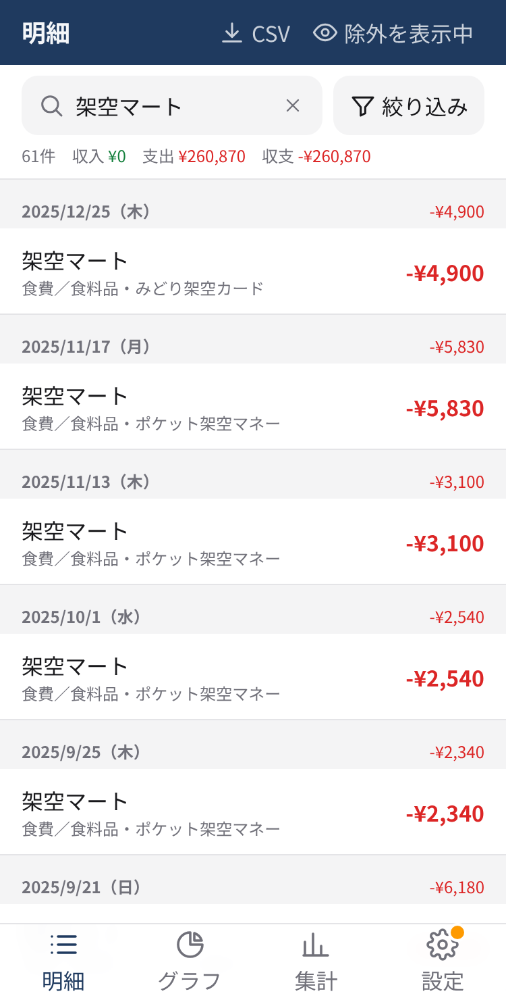
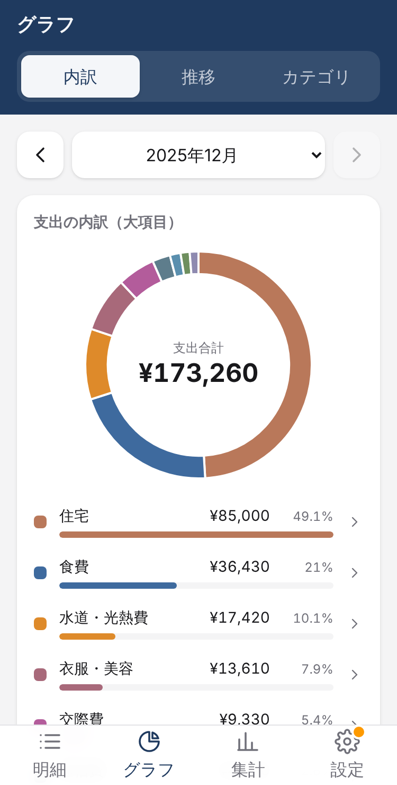
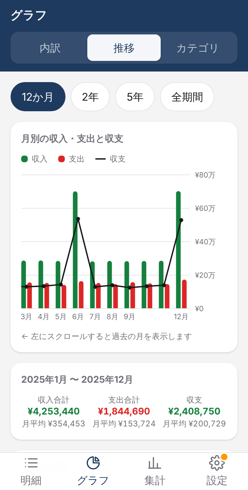
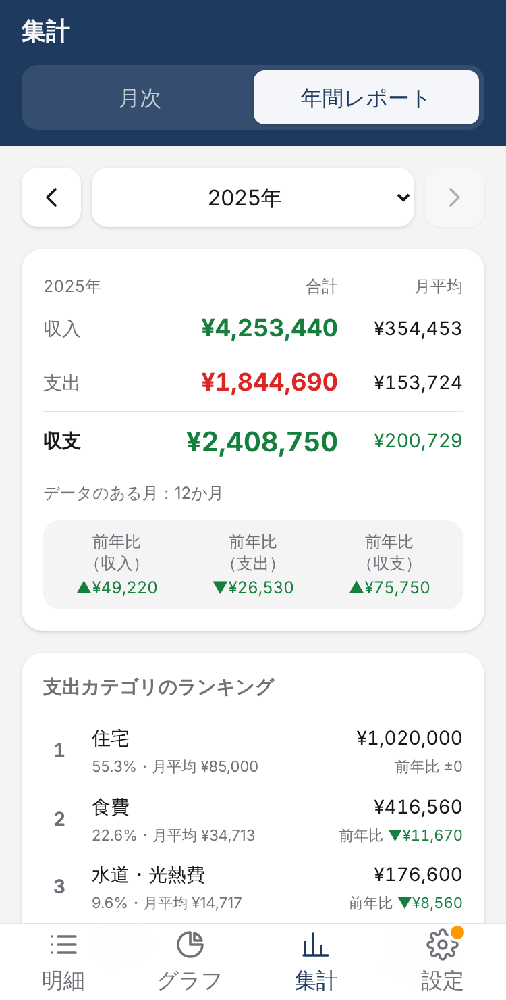

# mf-csv-viewer

マネーフォワードME からダウンロードした「収入・支出詳細」CSV を読み込み、明細の検索・集計ができる Web アプリです。
iPhone の Safari（ホーム画面に追加）での利用を想定しています。

公開URL: https://ossannote2025.github.io/mf-csv-viewer/

## このアプリを使うメリット

マネーフォワードME で見られる明細を、CSV に書き出して手元に置いておき、**昔の明細までまとめて探したり振り返ったりする**ためのアプリです。

- **何年前の明細でも、どの項目でも探せる**
  マネーフォワードME の公式ヘルプによると（2026年11月時点）、アプリの検索で探せるのは**過去5,000件までの明細の、タイトルだけ**です。分類・金額・金融機関名では検索できません。Web 版には明細を検索する機能そのものがなく、ブラウザのページ内検索を使うよう案内されています。明細が多い家計では、数年分で5,000件を超えてしまいます。
  このアプリでは、取り込んだ明細はすべて手元に残ります。10年分・数万件でも、キーワード（内容・メモ）・期間・大項目／中項目・金融機関・金額などで、全期間をまとめて検索できます。
  - 参考（マネーフォワードME 公式ヘルプ）：[入出金画面の表示を知ろう](https://support.me.moneyforward.com/hc/ja/articles/24478005732889)／[過去の明細履歴を検索したい](https://support.me.moneyforward.com/hc/ja/articles/8406759284377)
- **待たずに動く**
  明細はすべて端末の中にあるので、検索・絞り込み・集計・グラフの切り替えで通信を待ちません。電波の弱い場所や機内（オフライン）でも使えます。
- **長い期間で振り返れる**
  年間レポート（年の合計・月平均・前年比）、5年・全期間の推移グラフ、前年同月との比較などで、家計の変化を長い目で見られます。
- **実態に合った集計にできる**
  振替・立替金・カード引き落としの二重計上などを、除外ルールで集計から外せます（元のデータは消えません）。二重計上の候補も、アプリが見つけて知らせます。
- **データは端末の外に出ない**
  取り込んだデータは、ブラウザの中だけに保存されます。サーバーには送りません（詳しくは下の「データはブラウザ内だけに保存されます」）。
- **見つけた明細を CSV で書き出せる**
  絞り込んだ明細を CSV で保存し、Excel などで使えます。

### 知っておいてほしいこと

- CSV のダウンロードは、マネーフォワードME のプレミアム会員の機能です。
- マネーフォワードME と自動で連携するわけではありません。新しい明細は、ときどき CSV をダウンロードして取り込んでください（同じ明細を取り込み直しても、二重には数えません）。
- データは使っている端末の中にあります。機種変更や、データが消えたときに備えて、ときどきバックアップを書き出してください。

## 画面のイメージ

※ 画面の店名・金融機関名・金額はすべて架空のデータです。

<table>
  <tr>
    <td align="center" width="50%">
      <br>
      <b>明細</b><br>キーワードで検索。件数と収入・支出の合計もすぐ分かります
    </td>
    <td align="center" width="50%">
      <br>
      <b>グラフ：内訳</b><br>月ごとの支出をカテゴリ別に。タップで中項目・明細へ
    </td>
  </tr>
  <tr>
    <td align="center" width="50%">
      <br>
      <b>グラフ：推移</b><br>月別の収入・支出・収支。期間の合計と月平均も表示
    </td>
    <td align="center" width="50%">
      <br>
      <b>集計：年間レポート</b><br>年の合計・月平均・前年比と、支出カテゴリのランキング
    </td>
  </tr>
</table>

## 🔒 データはブラウザ内だけに保存されます

- 取り込んだ家計データは、**お使いの端末のブラウザ（IndexedDB）の中だけ**に保存されます。
- 外部のサーバーへは**一切送信しません**。バックエンド・外部API・アクセス解析・外部CDNは使っていません。
- さらに Content-Security-Policy で外部への通信をブラウザレベルで禁止しています。
- このリポジトリで公開しているのはプログラムだけです。実データはコミットしないでください（`.gitignore` と CI で防止しています）。

## できること（現在のバージョン）

- CSV の一括取り込み（複数ファイル・10年分でもOK、進捗表示、失敗ファイルの一覧）
  - 文字コードは Shift_JIS／UTF-8（BOMあり・なし）を自動判定
  - 列はヘッダー名で判定（列の順番が違っても可）。カンマ区切り・タブ区切りに対応
  - 明細の ID で重複を判定。同じ明細を何度取り込んでも二重に計上されません（最新の内容で上書き）
  - 期間は CSV の日付から自動判定（年をまたいでも、何年分でも可）
- 明細一覧（日付の新しい順、大量でも軽快な仮想スクロール）
- 検索・絞り込み（キーワード、期間、大項目／中項目、金融機関、収入／支出、金額範囲）
- 月次集計（収入・支出・収支、大項目別の支出内訳、前月比・前年同月比）
- 月次の支出レポートの印刷・PDF保存（集計タブ「月次」の「支出レポートを印刷・PDF保存」。詳しくは下の「支出レポートを印刷・PDF保存する」）
- 年間レポート（年ごとの合計・月平均、支出カテゴリのランキング、月別の収支、年ごとの比較。年の途中までのデータは前年の同じ月どうしで比較）
- 絞り込み結果の CSV エクスポート（明細タブ右上の「CSV」。UTF-8 BOM 付きで Excel でも文字化けしません。このアプリへの再取り込みも可能）
- ダークモード（iPhone の「外観モード」の設定に自動で追従）
- グラフ
  - 内訳：大項目別の支出ドーナツグラフ → タップで中項目 → さらにタップで該当する明細の一覧へ
  - 推移：月別の収入・支出（棒）と収支（折れ線）。期間は12か月／2年／5年／全期間（10年分でも横スクロールで表示）
  - カテゴリ：大項目・中項目ごとの月次推移（グラフ＋表）、前月比・前年同月比、大項目×月の一覧表
- 月・年の切り替え：集計（月次・年間レポート）・グラフの「内訳」では、矢印ボタンに加えて左右スワイプでも前後の月（年間レポートでは年）に移動できます（左へスワイプで次、右へスワイプで前）
- 除外ルール（集計から特定の明細を外す。データは削除しません）
  - 組み込みルール：振替・計算対象外（ON/OFF 可）
  - 独自ルール：内容（含む／完全一致／で始まる）、金融機関、大項目／中項目、金額範囲、収入／支出、適用期間を AND で指定。複数ルールは OR で適用
  - 作成時に「除外される件数・金額」をプレビュー。明細を長押し（PCでは右クリック）しても作成可
  - 除外された明細は一覧でグレー表示し、どのルールで除外されたかを表示
- 二重計上の候補（設定タブ「除外ルール」の一番上から確認。候補があるとタブバーの設定アイコンに印が付きます。集計タブ（月次）では表示中の月に候補があるときだけ案内を表示し、その月の候補だけを確認できます。CSV の取り込み結果には、その取り込みで新しく見つかった候補の件数を表示します。一覧は30件ずつ表示します）
  - カード引き落とし：銀行・信用金庫などの支出で、振替になっていないカードの引き落とし（電子マネー・通販サイトなどの支出や、「○○カード」という商品名などの買い物は対象外）。内容の表記ゆれ（半角カナ・ローマ字・略称）は、カード会社の辞書と、取り込み済みのカードの金融機関名との照合で判定し、カードごと（引き落とし口座ごと）にまとめて表示。カードの利用額とほぼ一致する引き落としには印を表示
  - 重複購入：金額が同じ・日付が3日以内・金融機関が異なる支出の組で、次のどちらかに当たるもの
    - 片方が通販サイト（Amazon・楽天市場など）。［カード側を除外］で除外
    - 内容がよく似ている（よくある言葉・数字を除いて4文字以上が共通。例：電子マネーの記録と、財布に手入力した記録）。どちらを除外するかを選べます
  - 「除外する」で除外ルールを作成（作成前に除外される件数・金額を表示）。「二重ではない」を選んだ候補は次から表示しません（一覧の下から元に戻せます。バックアップにも含まれます）
  - アプリが自動で除外することはありません
- バックアップ（全データ＋除外ルール＋「二重ではない」の記録を JSON で書き出し）と復元（置き換え／マージ）
- 取り込み済みの月の一覧と月単位の削除、全データ削除
- オフラインでも動作（PWA）。新しいバージョンが出ると画面下に「更新」ボタンが表示されます


## マネーフォワードME から CSV をダウンロードする

CSV は Web 版（PCのブラウザ）と iPhone アプリのどちらからダウンロードしたものでも取り込めます。

- Web 版：1ファイル＝1か月分
- iPhone アプリ：1ファイル＝1年分

同じ明細は ID で重複排除されるので、Web 版の月ごとのファイルと iPhone アプリの年ごとのファイルを混ぜて取り込んでも二重にはなりません。

### Web 版（PCのブラウザ）

1. https://moneyforward.com にログイン
2. 「家計簿」→「収入・支出詳細」を開く
3. 対象の月を表示し、「ダウンロード」→「CSVファイル」を選ぶ
4. 必要な月の分だけ繰り返す（1ファイル＝1か月分）

保存したファイルは iCloud Drive などに入れておくと、iPhone から選べます。

### iPhone アプリ

アプリからダウンロードした年ごとの CSV を「ファイル」アプリに保存しておけば、そのまま選べます。

## iPhone で取り込む

1. Safari で公開URLを開く（またはホーム画面のアイコンから開く）
2. 「CSVファイルを選ぶ」をタップ
3. 「ファイル」アプリが開くので、CSV のあるフォルダを開く
4. 右上の「選択」をタップし、取り込みたいファイルをまとめて選んで「開く」
5. 取り込み結果（成功件数・重複件数・失敗したファイル）が表示されます

PC では、ファイルを画面にドラッグ&ドロップしても取り込めます。

## ホーム画面に追加する（おすすめ）

1. Safari で公開URLを開く
2. 画面下の共有ボタン（□に↑のアイコン）をタップ
3. 「ホーム画面に追加」→「追加」

> ⚠️ **ホーム画面に追加したアプリと Safari のタブでは、データの保存場所が別です。**
> 普段使う方（ホーム画面のアプリがおすすめ）でCSVを取り込んでください。

## 支出レポートを印刷・PDF保存する

集計タブの「月次」で月を選び、「支出レポートを印刷・PDF保存」を押すと、その月の支出レポート（A4 縦）が開きます。

- 1ページ目：支出合計、前月比・前年同月比（支出どうし）、カテゴリ別の内訳（棒グラフと金額・割合）、大きな支出トップ10
- 2ページ目以降：明細一覧（日付順。日付・内容・金額・大項目。長い内容は1行に省略。内容と1行に収まるときはメモも表示。最後の行に支出合計）
- **支出だけを載せます。** 収入の明細・収入合計・収支は載りません。振替・計算対象外・除外ルール（二重計上の「除外する」を含む）で外した明細も載りません
- 支出合計は集計タブの「支出」と同じです（設定で「振替」「計算対象外」のルールを OFF にしているときだけ異なり、そのときは画面に案内が出ます）

**PDF にするには**
- iPhone：「印刷する」→ 印刷画面の右上の共有ボタン →「"ファイル"に保存」
- パソコンの Chrome：「印刷する」→ 送信先を「PDF に保存」（「ヘッダーとフッター」はオフがおすすめ。ページ番号はレポート側で入ります）
- 印刷画面が開かないとき（ホーム画面から起動したアプリなど）：「印刷・PDF保存のしかた」を開き、「ファイルとして保存（HTML）」で保存 →「ファイル」アプリで開いて、共有 →「プリント」から印刷・PDF保存できます。保存したファイルは端末の中だけにあり、外部には送られません

## バックアップの重要性

iPhone の Safari には、しばらく使われていないサイトのデータを自動で削除する仕組みがあります。
このアプリは保存の永続化をリクエストしていますが、端末の故障や機種変更などに備えて、
**定期的なバックアップ**をおすすめします（最後のバックアップから30日以上たつと、設定タブに印が付きます）。

### バックアップのしかた（iPhone）

1. 「設定」タブ →「バックアップを書き出す」
2. 共有メニューが開くので「"ファイル"に保存」を選ぶ
3. 「iCloud Drive」などの保存先を選んで「保存」

### 復元のしかた

1. 「設定」タブ →「バックアップから復元」
2. 「ファイル」アプリで保存したバックアップ（`mf-csv-viewer-backup-…json`）を選ぶ
3. 「置き換え」（今のデータを消してバックアップの内容にする）か「マージ」（今のデータに追加）を選んで「復元する」

> ⚠️ バックアップファイルや書き出した CSV には家計データがそのまま含まれます。人に送ったり、GitHub などに公開したりしないでください。

元の CSV ファイルを iCloud Drive などに残しておけば、いつでも取り込み直すこともできます。

## 開発者向け

```bash
npm install
npm run dev              # 開発サーバー
npm test                 # ユニットテスト（Vitest）
npm run lint             # ESLint
npm run build            # 本番ビルド（dist/）
npm run check:data       # 実データの誤コミットチェック
npm run generate:sample  # 架空のサンプルCSVを sample/ に再生成
npm run screenshots      # README の画面イメージ（docs/screenshots/）を架空データで撮り直す（要 Playwright・日本語フォント）
```

- 技術: Vite + React + TypeScript / Tailwind CSS / Dexie.js（IndexedDB）/ PapaParse / TanStack Virtual / Zustand / Recharts / vite-plugin-pwa
- `sample/` には架空の店名・金融機関名で作ったテスト用CSVだけを置いています（Shift_JIS・UTF-8 BOMあり・UTF-8 BOMなし。`*-doublecount-*.csv` は二重計上の候補の確認用）
- `main` ブランチに push すると GitHub Actions で GitHub Pages にデプロイされます
- IndexedDB のスキーマを変更するときは `src/db/schema.ts` に新しい `version()` を追加し、既存データのマイグレーションを書くこと
