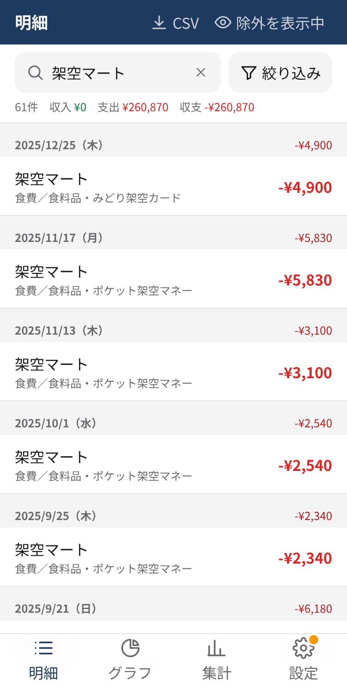
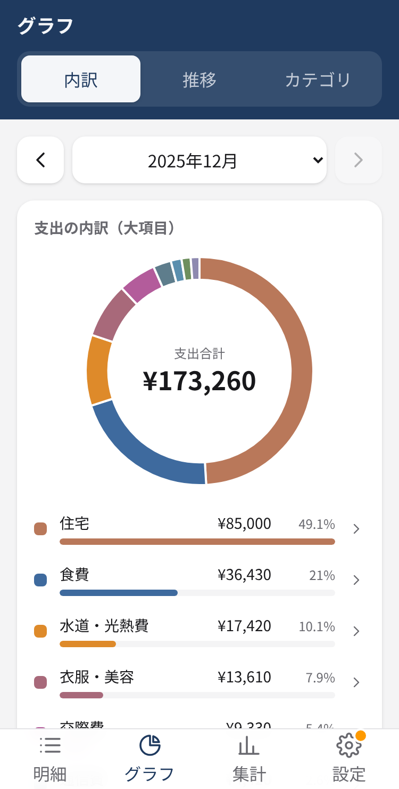
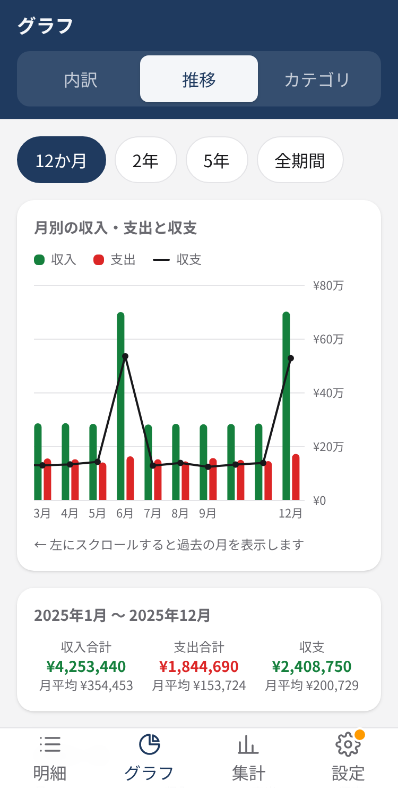
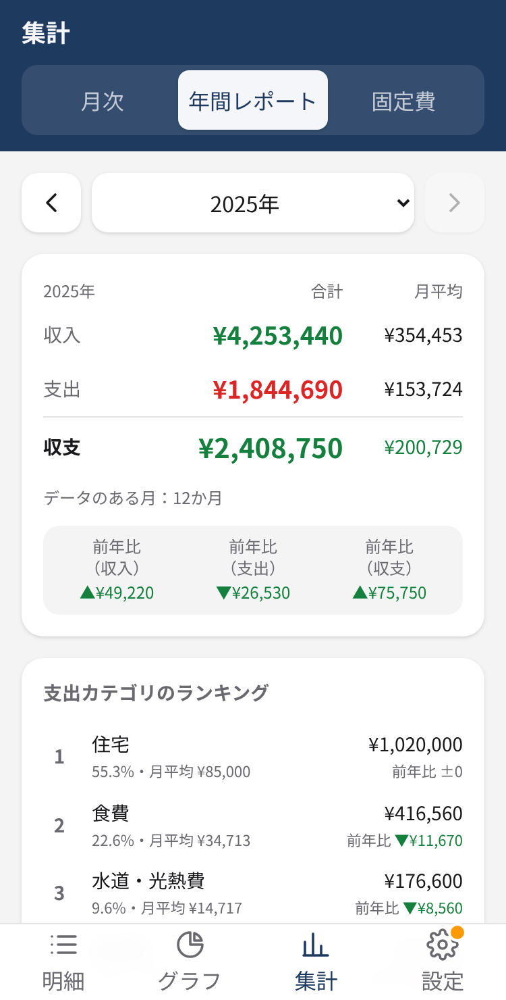

# mf-csv-viewer

マネーフォワードME からダウンロードした「収入・支出詳細」CSV を読み込み、明細の検索・集計ができる Web アプリです。
iPhone の Safari（ホーム画面に追加）での利用を想定しています。

公開URL: https://ossannote2025.github.io/mf-csv-viewer/

## できること

マネーフォワードME の明細を CSV で手元に置き、**昔の明細まで探したり、長い目で振り返ったりする**ためのアプリです。

- **全期間の明細を検索**：何年分・何万件でも、キーワード（内容・メモ）・期間・カテゴリ・金融機関・金額でまとめて探せます（マネーフォワードME のアプリの検索は、過去5,000件のタイトルだけ。2026年11月時点の[公式ヘルプ](https://support.me.moneyforward.com/hc/ja/articles/8406759284377)より）
- **月次・年間の集計とグラフ**：カテゴリ別の内訳、月別の推移（最長で全期間）、前月比・前年比、年の合計と月平均
- **固定費の一覧**：毎月・毎年の支払いの候補から、固定費を選んで月あたりの合計を見られます
- **二重計上の発見**：振替になっていないカードの引き落としや、通販とカードの重複を知らせます。除外ルールで集計から外せます（元のデータは消えません）
- **支出レポートの印刷・PDF保存**：家族に見せる用に、月の支出だけをまとめたレポート
- **CSV の書き出しとバックアップ**：絞り込んだ明細を Excel などで使えます
- **データは端末の外に出ない**：保存はブラウザの中だけ。通信を待たないので速く、オフラインでも動きます

### 知っておいてほしいこと

- CSV のダウンロードは、マネーフォワードME のプレミアム会員の機能です。
- マネーフォワードME と自動では連携しません。新しい明細は、ときどき CSV をダウンロードして取り込んでください（同じ明細を取り込み直しても、二重には数えません）。
- データは使っている端末の中にあります。機種変更などに備えて、ときどきバックアップを書き出してください。

## 画面のイメージ

※ 画面の店名・金融機関名・金額はすべて架空のデータです。

<table>
  <tr>
    <td align="center" width="50%">
      <br>
      <b>明細</b><br>キーワードで検索。件数と収入・支出の合計もすぐ分かります
    </td>
    <td align="center" width="50%">
      <br>
      <b>グラフ：内訳</b><br>月ごとの支出をカテゴリ別に。タップで中項目・明細へ
    </td>
  </tr>
  <tr>
    <td align="center" width="50%">
      <br>
      <b>グラフ：推移</b><br>月別の収入・支出・収支。期間の合計と月平均も表示
    </td>
    <td align="center" width="50%">
      <br>
      <b>集計：年間レポート</b><br>年の合計・月平均・前年比と、支出カテゴリのランキング
    </td>
  </tr>
</table>

## はじめかた

### 1. ホーム画面に追加する

1. Safari で公開URLを開く
2. 画面下の「…」→「共有」をタップ（共有ボタン（□に↑）が見えていれば、それをタップ）
3. 「ホーム画面に追加」→「追加」（「Webアプリとして開く」が出たら、オンのまま）
4. 以降は、ホーム画面のアイコンから開く

> ⚠️ **ホーム画面に追加したアプリと Safari では、データの保存場所が別です。** 先に追加してから取り込んでください。
> Safari のままだと、しばらく使わないとデータが消えることがあります。

### 2. マネーフォワードME から CSV をダウンロードする

- **iPhone アプリ**：「マイページ」→「入出金データをダウンロード」→ 年を選ぶ → 共有シートで「"ファイル"に保存」（1ファイル＝1年分）
- **PC（Web版）**：ログイン →「家計簿」→「収入・支出詳細」→ 月を選んで「ダウンロード」→「CSVファイル」（1ファイル＝1か月分）。iCloud Drive などに入れておくと iPhone から選べます

両方を混ぜて取り込んでも、二重にはなりません。

### 3. 取り込む

「CSVファイルを選ぶ」→「ファイル」アプリで CSV を選ぶ（右上の「選択」でまとめて選べます）。PC ではドラッグ&ドロップもできます。

### まずはサンプルで試す

自分のデータを入れる前に、架空の家計（約4年分・約3,000件）で試せます。最初の画面（または設定タブの取り込み欄）の「**サンプルをそのまま取り込む**」を押すだけです。試したあとは、設定タブの「データの削除」→「サンプルの明細だけを削除」で消せます。
実際の手順も試したいときは、「ファイルから取り込む手順も試す」→「CSVを保存」で保存したファイルを、「CSVファイルを選ぶ」から取り込みます。

## 🔒 データとバックアップ

- 取り込んだデータは、**端末のブラウザ（IndexedDB）の中だけ**に保存され、外部のサーバーには**一切送信しません**（サーバー・外部API・アクセス解析・外部CDN は使わず、Content-Security-Policy で外部への通信も禁止しています）。
- 端末の故障や機種変更に備えて、**ときどきバックアップを書き出してください**（最後のバックアップから30日以上たつと、設定タブに印が付きます）。
  - 書き出し：設定タブ →「バックアップを書き出す」→「"ファイル"に保存」
  - 復元：設定タブ →「バックアップから復元」→ ファイルを選び、「置き換え」か「マージ」
- バックアップや書き出した CSV には家計データがそのまま入っています。人に送ったり、公開したりしないでください。
- アプリが開けなくなったときは「エラー」の画面が出ます。そこから「もう一度読み込む」「バックアップを書き出す」「全データ削除」ができます。

## 機能の詳しい説明

<details>
<summary>取り込み</summary>

- 複数ファイルをまとめて取り込めます（10年分・120ファイルでもOK）。進み具合と、失敗したファイルの一覧を表示
- 文字コード（Shift_JIS／UTF-8／UTF-16）と列（ヘッダー名で判定）は自動で判定。カンマ区切り・タブ区切りに対応
- 明細の ID で重複を判定し、同じ明細は最新の内容で上書き
- **今回の CSV にない明細**：マネーフォワードで削除・統合した明細が残っているとき、取り込み結果に件数を出します。「確認する」で一覧を開き、チェックを付けた明細だけを削除できます（自動では消しません。このアプリが書き出した CSV と、読み飛ばした行のある CSV は対象外）

</details>

<details>
<summary>明細の検索と除外ルール</summary>

- 明細一覧は日付の新しい順。大量でも軽く動きます
- 絞り込み：キーワード・期間・大項目／中項目・金融機関・収入／支出・金額の範囲。結果は明細タブ右上の「CSV」で書き出せます（UTF-8 BOM 付き。このアプリへの再取り込みも可）
- 除外ルール：集計から特定の明細を外します（データは消しません）
  - 組み込み：振替・計算対象外（ON/OFF 可）
  - 独自ルール：内容（含む／完全一致／で始まる）・金融機関・カテゴリ・金額・収入／支出・期間の組み合わせ。作る前に、外れる件数・金額を表示。明細の長押し（PC では右クリック）からも作れます
  - 外れた明細は一覧で灰色になり、どのルールで外れたかを表示

</details>

<details>
<summary>二重計上の候補</summary>

設定タブ「除外ルール」の一番上で確認します（候補があると設定アイコンに印。集計タブの月次では、その月の候補だけを確認できます）。アプリが自動で除外することはありません。

- **カード引き落とし**：銀行・信用金庫などの支出で、振替になっていないカードの引き落とし。半角カナ・ローマ字・略称の表記ゆれも照合し、カードごとにまとめて表示
- **重複購入**：金額が同じ・3日以内・金融機関が違う支出の組で、片方が通販サイトのもの、または内容がよく似ているもの
- 「除外する」で除外ルールを作ります。「二重ではない」を選んだ候補は次から出ません（元に戻せます。バックアップにも入ります）

</details>

<details>
<summary>集計・グラフ・固定費</summary>

- **月次**：収入・支出・収支、大項目別の内訳、前月比・前年同月比
- **年間レポート**：年の合計・月平均、支出カテゴリのランキング、月別の収支、年ごとの比較（年の途中までのデータは、前年の同じ月どうしで比較）
- **グラフ**：内訳（ドーナツグラフ → タップで中項目 → 明細へ）、推移（12か月・2年・5年・全期間）、カテゴリ（大項目・中項目ごとの月次推移と一覧表）
- 月・年は矢印ボタンか、左右のスワイプで切り替え
- **固定費**：同じ名前の支出が直近12か月のうち3か月以上あるもの、毎年同じころにあるもの（年1回）を候補に出し、「入れる」「入れない」を自分で選びます（食費・交通費などは候補にしません）。入れたものは大項目ごとに、月あたりの金額（12か月の合計÷12。年1回は1回分÷12）で表示。最近止まったものも表示。タップでその明細の一覧へ

</details>

<details>
<summary>支出レポートの印刷・PDF保存</summary>

集計タブの「月次」で月を選び、「支出レポートを印刷・PDF保存」を押すと、その月のレポート（A4 縦）が開きます。

- 1ページ目：支出合計、前月比・前年同月比、カテゴリ別の内訳、大きな支出トップ10
- 2ページ目以降：明細一覧（日付・内容・金額・大項目）
- **支出だけを載せます。** 収入・収支、振替・計算対象外・除外ルールで外した明細は載りません
- PDF にするには
  - iPhone：「印刷する」→ 印刷画面の右上の共有ボタン →「"ファイル"に保存」
  - パソコンの Chrome：「印刷する」→ 送信先を「PDF に保存」（「ヘッダーとフッター」はオフがおすすめ）
  - 印刷画面が開かないとき（ホーム画面のアプリなど）：「印刷・PDF保存のしかた」→「ファイルとして保存（HTML）」→「ファイル」アプリで開いて、共有 →「プリント」

</details>

<details>
<summary>そのほか</summary>

- ダークモード（iPhone の外観モードに自動で合わせます）
- オフラインでも動きます（PWA）。新しいバージョンが出ると、画面下に「更新」ボタンが出ます
- 取り込み済みの月の一覧と、月ごとの削除・全データ削除

</details>

## 開発者向け

```bash
npm install
npm run dev              # 開発サーバー
npm test                 # ユニットテスト（Vitest）
npm run lint             # ESLint
npm run build            # 本番ビルド（dist/）
npm run check:data       # 実データの誤コミットチェック
npm run generate:sample  # 架空のサンプルCSVを sample/ に再生成
npm run generate:demo    # アプリで配るサンプル（public/sample/ と src/lib/sampleFiles.ts）を再生成
npm run screenshots      # README の画面イメージ（docs/screenshots/）を架空データで撮り直す（要 Playwright・日本語フォント）
```

- 技術: Vite + React + TypeScript / Tailwind CSS / Dexie.js（IndexedDB）/ PapaParse / TanStack Virtual / Zustand / Recharts / vite-plugin-pwa
- `sample/` には架空の店名・金融機関名で作ったテスト用CSVだけを置いています（Shift_JIS・UTF-8 BOMあり・UTF-8 BOMなし。`*-doublecount-*.csv` は二重計上の候補の確認用）
- `public/sample/` は、アプリから取り込み・保存できる架空の家計（1年1ファイル）です。明細の ID はすべて `SAMPLE＋数字` で、`npm run check:data` で確かめています
- このリポジトリで公開しているのはプログラムだけです。実データはコミットしないでください（`.gitignore` と CI（`npm run check:data`）で防いでいます）
- `main` ブランチに push すると GitHub Actions で GitHub Pages にデプロイされます
- IndexedDB のスキーマを変更するときは `src/db/schema.ts` に新しい `version()` を追加し、既存データのマイグレーションを書くこと
